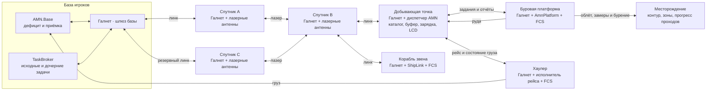

# ТЗ ScriptTest — AMN, FCS, помощь в бою и Галнет

**Галнет** — транспортная сеть для Space Engineers. Она связывает базы, добывающие точки, корабли и спутники с лазерными антеннами. По ней идут задания TaskBus, отчёты AMN, состояние узлов и обмен игровыми целями. **FCS** остаётся локальным контроллером корабля: полёт, торможение, финальный подход и освобождение управления выполняются на борту. Так перестройка сети не прерывает контур управления тягой и гироскопами.

## Предварительная схема

На базе **`TaskBroker` — отдельный ПБ**. Спутники пересылают сообщения и знают состояние маршрутов. Очередь задач хранится у брокера. Если отказал лазерный путь, Галнет ищет обход к тому же брокеру. Если отказал сам брокер, восстановление связи и восстановление очереди — два разных сценария приёмки.

## ПБ и контуры управления

| ПБ | Ответственность |
|---|---|
| **Галнет** | На базе, точке, корабле и спутнике. Следит за соседями, строит маршрут, пересылает сообщения и сообщает локальным приложениям о потере или восстановлении связи. |
| **TaskBroker** | На базе. Выдаёт аренды, проверяет поколения аренды, хранит очередь и результаты. TaskBus сохраняет свои ID сообщений и правила повторной доставки при переходе на Галнет. |
| **AMN** | База создаёт заявку и подтверждает приёмку. Точка ведёт стадии `разведка → цикл добычи → транспортировка`, выбирает месторождение, выдаёт зоны и резервирует груз в буфере. Платформа совмещает разведку и добычу. Хаулер возит груз с точки на базу-заявителя. |
| **FCS** | На пилотируемых и автономных кораблях. Управляет тягой и гироскопами, оценивает торможение, выполняет локальные манёвры и стыковку. На автономном рейсе контролирует переход `Recharge` после стыковки и `Auto` перед отстыковкой. |
| **ShipLink** | На кораблях звена. Показывает связь, состояние союзников, запросы помощи и общие отметки целей. Пилот может выбрать отметку для сопровождения в интерфейсе и видеть её источник и давность. |

## Протокол Галнет

**Соседство и маршрутизация.** У каждого узла постоянный ID и поколение запуска. Соседи обмениваются `HELLO` и подтверждают двустороннюю доступность. Узлы распространяют список доступных связей с версией и сроком годности. Галнет выбирает маршрут по состоянию связей и числу переходов. При потере соседа удаляет его из маршрута, пересчитывает путь и повторяет ожидающие отправки.

**Лазерные спутники.** Предварительно известные соседи хранятся в конфигурации узла. При потере лазерной связи узел проверяет альтернативные доступные линкованные узлы. Если обхода нет, пытается восстановить настроенные связи с ограниченной частотой. После возвращения линка узлы обмениваются актуальным состоянием топологии. Как именно ПБ сможет управлять наведением и восстановлением связей, нужно проверить в игре с вашим набором модов.

**Доставка.** Конверт содержит версию протокола, ID отправителя и получателя, ID сообщения, срок годности и предел переходов. Прикладное подтверждение отправляет конечный получатель. Повтор после смены маршрута сохраняет ID. Дубликаты отбрасываются, а задания и квитанции хранятся в ограниченных очередях. Для телеметрии и целей достаточно последних актуальных данных.

**Разрыв сети.** Пока маршрута нет, критичные сообщения ждут восстановления в пределах срока годности. Работа с истёкшей арендой приостанавливается по правилам TaskBus. Возврат связи запускает сверку аренды и отчётов перед продолжением. Резервирование самого брокера — отдельный этап, с восстановлением очереди и проверкой, что активный брокер только один.

## Heartbeat и обмен целями

Разделю heartbeat на **состояние узла** и **состояние окружения**:

- **Узел** сообщает роль, доступность, активную задачу и режим корабля. Пропавший heartbeat помечает узел как недоступный, а последнее известное состояние остаётся видимым с отметкой времени.
- **Окружение** передаётся как наблюдения. Для них нужны источник, координаты, время и срок актуальности. Например, рудная находка, препятствие на подходе или отметка игрового контакта.
- **Цели звена** содержат ID отметки, источник, последнее положение и, если доступна, скорость. ShipLink объединяет повторы, показывает возраст и убирает просроченные отметки из активного списка. Потерянный контакт и подтверждённое наблюдение должны различаться на экране. Помощь в бою включает общую картину звена, предупреждения и запросы помощи. Команда на манёвр остаётся у пилота.

## Порядок реализации и приёмка

| Этап | Критерий приёмки |
|---|---|
| **1. Галнет и резервные пути** | База, два маршрута через спутники и удалённая точка. Разрыв основного линка переключает доставку на резервный. При разрыве обоих путей сообщение ждёт и после восстановления приходит один раз на прикладном уровне. |
| **2. TaskBus поверх Галнета** | При отключении спутника посреди аренды задача не дублируется. После перезапуска узла отчёт восстанавливается, а запоздавший отчёт по истёкшей аренде отклоняется. |
| **3. AMN и FCS** | Добыча на участке в гравитации и на астероиде. Платформа уточняет контур, продолжает с сохранённого прохода, возвращается на точку, разгружается и заряжается. Хаулер завершает заявку квитанцией фактической приёмки на базе. |
| **4. Звено и цели** | Два корабля обмениваются отметками и запросами помощи через спутник. При разрыве связь и отметки устаревают, при восстановлении появляются свежие данные. FCS остаётся управляемым во время перестройки сети. |
| **5. Восстановление брокера** | После отказа узла очередь и подтверждения восстанавливаются из согласованного состояния. Проверка включает разделение сети и исключение двух активных брокеров. |

Схема описывает целевую систему. В коде уже есть TaskBus поверх IGC, локальные функции FCS, часть цикла AMN и телеметрия ShipLink. **Галнет, лазерная маршрутизация, обмен отметками целей и восстановление брокера ещё предстоит реализовать.** Работу держу на паузе, код в этом шаге не менял.